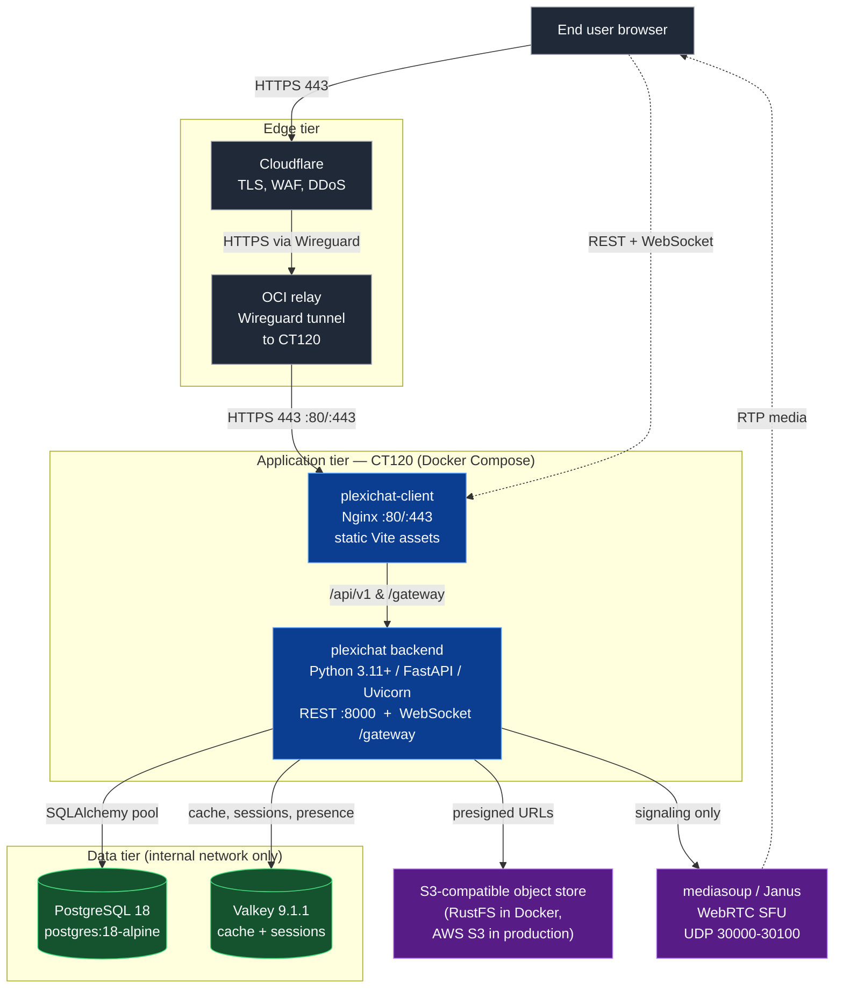

# Deployment overview

Plexichat is a distributed messaging platform that you can deploy from local development to production. This guide describes the deployment options and architecture.

## Deployment options

Plexichat supports the following strategies:

- **Development** — Local setup with SQLite.
- **Production** — PostgreSQL 18 with Valkey caching and S3-compatible object storage.
- **Containerized** — Docker Compose stack with standalone deploy scripts. This is the recommended production method.
- **Manual or development** — Direct installation from a Git clone.
- **Cloud** — Deployment on your own cloud provider or VM.

## Architecture

Plexichat uses three tiers. End-user traffic terminates at the edge, tunnels to the application container, and fans out to the data tier through the FastAPI backend.



## Key components

1. **Backend server (`plexichat`)** — Python 3.11+ and FastAPI app that serves the REST API and WebSocket gateway.
2. **Client (`plexichat-client`)** — Vite web app served by Nginx.
3. **Shared utilities (`common_utils`)** — Internal Python helpers at `plexichat/src/utils/common_utils/` used only by the server. The web client lives in a separate repository and does not share this package.
4. **Database** — PostgreSQL 18 (recommended) or SQLite (development only).
5. **Cache** — Valkey 9.1.1 (recommended for production).
6. **Storage** — Local filesystem or S3-compatible storage (RustFS `1.0.0-rc.3` in Docker, AWS S3 in production) for media attachments.
7. **WebRTC SFU (`mediasoup` default, `Janus` alternative)** — Optional signaling peer for voice and video. Media plane uses UDP 30000-30100.
8. **Reverse proxy and TLS (`plexichat-client` Nginx)** — Terminates TLS and proxies `/api/v1` and `/gateway` to the backend.

## Prerequisites

Before you deploy, install:

- Git 2.20+ for cloning repositories
- Python 3.11+ for the server. Python 3.10 is not supported.
- pip 21.0+
- Node.js 20+ only if you run client end-to-end tests with Playwright
- PostgreSQL 18 for production. The Docker Compose file uses `postgres:18-alpine`.
- Valkey 7+ for production. The Docker Compose file uses `valkey/valkey:9.1.1-alpine`.

For detailed system requirements, see [Requirements](requirements.md).

## Primary deployment flow

The recommended way to deploy is the standalone deploy scripts. They generate credentials, create configuration, and download container images without requiring a Git clone.

**Linux or macOS:**

```bash
curl -sSL https://plexichat.com/deploy.sh | bash
```

**Windows (PowerShell):**

```powershell
irm https://plexichat.com/deploy.ps1 | iex
```

The scripts support optional profiles:

```bash
# Include local AI moderation (Shieldstral)
./deploy.sh --profile ai

# Include typo-tolerant search
./deploy.sh --profile search-meilisearch
```

## Manual deployment flow (development)

1. Clone the repositories from GitLab.
2. Install dependencies for the server and client.
3. Configure environment variables and configuration files.
4. Initialize the database. This happens automatically on first startup.
5. Start the services.
6. Verify the deployment through health check endpoints at `GET /api/v1/ready` and `GET /api/v1/health`.

For configuration details, see the [Configuration overview](../configuration.md) and the per-subsystem guides linked from the [Deployment index](index.md).
